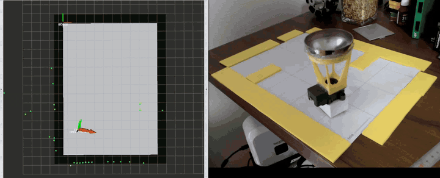
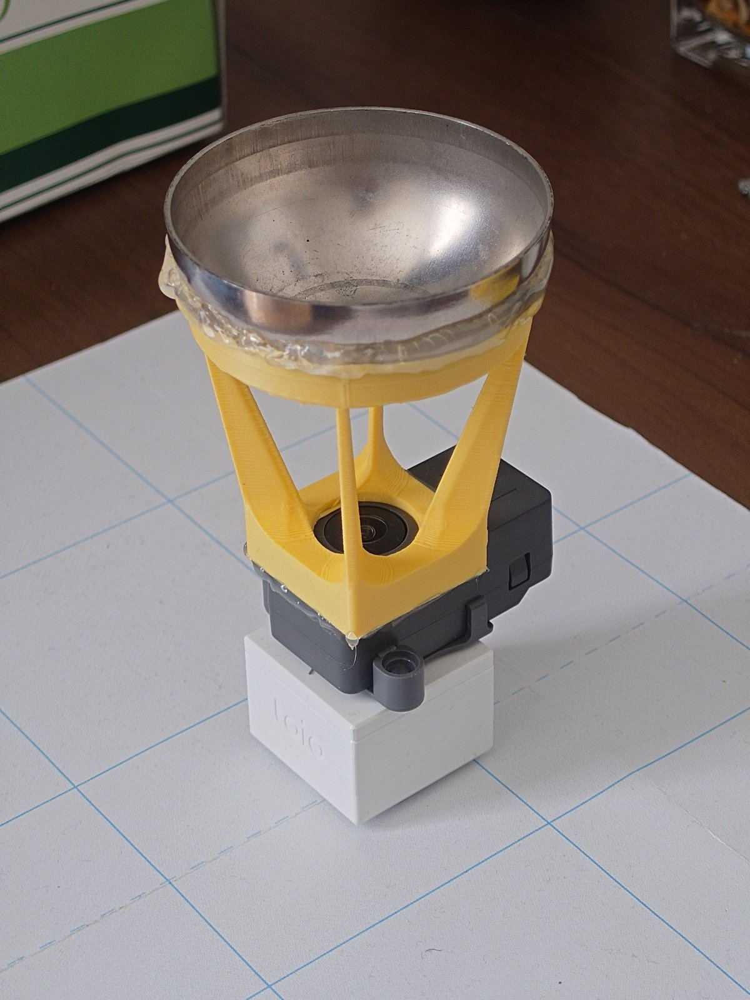

# toio-omni-range-sensor



*nav2 で障害物を避けて走っているところ。左が RViz（LaserScan と経路）、右が実機。現行構成（黄色ホルダー・半球鏡）、実時間、8 fps。*

toio 用の全周距離センサ。M5Stack **Timer Camera F** と凸面鏡を組み合わせたカタディオプトリック系で
全周を 1 枚の画像に写し、地面と物体の**彩度差**から 5 度刻み・72 方向の距離を出す。

現在のステータス: **ステップ 6 まで実機で動作**（上の動画は RViz に出た LaserScan）

| ステップ | 内容 | 状態 |
|---|---|---|
| 1 | Timer Camera F の映像を取得し、凸面鏡で全周が写ることを確認 | 完了 |
| 2 | 環状画像 → パノラマ展開のキャリブレーション（中心・内外半径） | 完了（`omni_viewer.py`） |
| 3 | 彩度ベースの地面／物体境界検出 → 72 方向の半径 | 完了（`omni_range.py`） |
| 4 | 半径 → 距離への変換（鏡形状の校正） | 完了（`fit_range.py`、6 点 rms 0.9 px）|
| 5 | オンデバイス処理と BLE 出力 | 完了（4.1 Hz、取りこぼし 0）|
| 6 | ROS 2 への出力（LaserScan） | 完了（RViz で確認） |

## 現在の構成

| 項目 | 値 |
|---|---|
| 鏡 | uxcell ステンレス製中空半球、直径約 60 mm |
| ホルダー | `stl/mirror_holder.stl`（黄色、腕 4 本）。鏡とカメラの位置を固定する |
| 測定 framesize | **CIF 400x296**（RGB565）。全画角が入る中でいちばん速い |
| 較正 | `cx=265.6, cy=235.7, r_in=25.6, r_out=200`（640 幅換算） |
| 距離フィット | `r(d) = -8.31 + 115.76*arctan(d/7.300)`、実測 4.5〜21 cm、rms 0.9 px |
| LaserScan の範囲 | **0.036 〜 0.233 m** |
| レート | 4.1 Hz（`scan_period` 200 ms） |
| フレームの鮮度 | 測定するフレームは約 98 ms 前のもの |

**この表の数字は測定 framesize と一体**で、解像度を変えると較正は移らない（後述）。

数字の出どころは以下の各ステップに書いてある。**凸面鏡 → 円錐 → 半球ステンレスと鏡を 3 回替えている**。
前の鏡での実測と、採用しなかった案（円錐・六角錐）の検討は [NOTES.md](NOTES.md) に分けてある。

---

## 構成

```
firmware/timercam_stream/   Timer Camera F 用 PlatformIO プロジェクト（MJPEG 配信）
tools/omni_common.py        フレーム取得・パノラマ展開・較正・マスクの共通実装
tools/omni_viewer.py        ビューア。全周判定と鏡の較正（cx,cy,r_in,r_out,theta0）
tools/mask_editor.py        無視領域マスクの作成（自動生成＋手描き修正）
tools/omni_range.py         ステップ 3 本体。72 方向の地面／物体境界を検出
tools/fit_range.py           ステップ 4。半径 → 距離のフィット
tools/make_synthetic_omni.py  ハード無しでツールを試すための合成画像生成
tools/ble_client.py         BLE でスキャンを受信する CLI
tools/gen_firmware_calib.py 較正 → デバイス用 C ヘッダ・ROS パラメータの生成
calib/mirror_calib.json     鏡のキャリブレーション
calib/ignore_mask.png       無視領域マスク（パノラマ座標、白=使う / 黒=無視）
stl/mirror_holder.stl       鏡ホルダー（3D プリント用）
ros2/toio_omni_range/       ROS 2 ドライバ。BLE → sensor_msgs/LaserScan
  toio_omni_range/omni_protocol.py  パケット定義（ble_client.py と共有）
ros2/toio_omni_bringup/     toio_ros2 と一緒に起動する bringup、nav2 launch、collision_monitor、マットの地図
ros2/toio_omni_mapping/     マットを走り回って地図を作る（Position ID を真値にした占有格子）
docker/                     ROS 2 用コンテナ（このリポジトリに ROS は要らない）
```

## ROS 2 ワークスペースへの組み込み

**このリポジトリは、そのまま `colcon_ws/src/` に置いて（またはサブモジュールにして）よい。**
colcon は `package.xml` のあるディレクトリしか拾わないので、`firmware/` `tools/` `calib/` は
無視され、ビルドされるのは `ros2/` の 3 パッケージだけになる。

```bash
cd colcon_ws/src
git submodule add https://github.com/<you>/toio-omni-range-sensor.git   # または git clone
pip install bleak            # rosdep では解決できない唯一の依存
cd .. && colcon build --symlink-install
```

| パッケージ | 中身 | 依存 |
|---|---|---|
| `toio_omni_range` | センサのドライバ。BLE → `sensor_msgs/LaserScan` | rclpy、bleak |
| `toio_omni_bringup` | キューブ（`toio_ros2`）とセンサを一緒に上げる bringup、nav2、collision_monitor | `toio_ros2`、navigation2 |
| `toio_omni_mapping` | マットの地図作成 | `toio_omni_bringup`、nav2_map_server |

センサだけ使うなら `toio_omni_range` だけで足り、`toio_ros2` が無くてもビルドは通る
（bringup と mapping は exec_depend なので、無い依存は起動時にだけ効く）。

`docker/` はこの配置をそのまま使っている。隣に `toio_ros2_dev_kit` がチェックアウトされて
いればキューブのドライバ `toio_ros2` もマウントされる。

## ハードウェア



| 部品 | 役割 |
|---|---|
| toio コアキューブ | 台車。平らなトッププレートの上にすべてを載せる |
| M5Stack Timer Camera F（K034-F） | ESP32 + OV3660 + 魚眼レンズ。レンズを真上に向けて置く |
| 鏡ホルダー `stl/mirror_holder.stl` | 3D プリント品。カメラのレンズ周りに座り、腕 4 本で鏡を支える |
| uxcell ステンレス製中空半球（直径約 60 mm、[Amazon](https://amzn.asia/d/084Gm1Y4)） | 凸面を下（カメラ側）に向けてホルダーのリングに載せる |

組み立ては下から順に、

1. toio のトッププレートに Timer Camera F を**両面テープ**で貼る（レンズが上）。
2. カメラの上にホルダーの基部を載せ、**ホットグルー**で固定する。
3. ホルダーのリングに鏡を載せ、縁を**ホットグルー**で固定する。

ホルダー・鏡の接着はすべてホットグルーで、外して付け直せる。ただし
**鏡とカメラの距離・傾き・ホルダーの回転が変わると較正とマスクは移らない。**
付け直したらステップ 2〜4（中心、マスク、距離フィット）をやり直すこと。
腕の方位（+48 / +138 / −134 / −44 度）はホルダーが toio の前方に対してどう回って
付いているかで決まり、いまのマスクはこの個体の取り付けに対するものになっている。

ホルダーが黄色なのは意図的で、鏡に写り込む基部と腕を**色相でマスクする**ため
（ステップ 3 の「ホルダーは色相で落とす」）。別の色で刷るなら `--holder-hue` を合わせる。

ピン配置は [m5stack/TimerCam-arduino](https://github.com/m5stack/TimerCam-arduino) に合わせてある。

| 用途 | GPIO |
|---|---|
| 電源保持（LDO ホールド） | 33 |
| LED | 2 |
| バッテリ電圧 ADC | 38 |
| カメラ XCLK / SIOD / SIOC | 27 / 25 / 23 |

**GPIO33 を HIGH に保持しないとバッテリ駆動時に電源が落ちる。** `setup()` の先頭で立てている。

カメラが上向き、その上に凸面鏡が下向きなので、画像にはドーナツ状（環状）に周囲が写り、
中心付近はカメラとホルダー基部の映り込み、外周が水平方向（遠方）に対応する。

## ファームウェアの書き込み

```bash
cd firmware/timercam_stream
cp include/wifi_config.h.example include/wifi_config.h
$EDITOR include/wifi_config.h        # WIFI_SSID を空のままにすると AP モードで起動
~/.platformio/penv/bin/pio run -t upload
~/.platformio/penv/bin/pio device monitor
```

シリアルに URL が出る。

```
joining "..."........
STA  http://192.168.128.161/
     http://192.168.128.161:81/stream
```

`WIFI_SSID` が空、または join に失敗した場合は SSID `TimerCamF-XXXX` /
パスワード `omnivision` の AP を立てて `http://192.168.4.1/` になる。
ただし AP モードは実用にならない（下記「接続方式の選び方」）。

エンドポイント:

| URL | 内容 |
|---|---|
| `http://<ip>/` | ブラウザ用オーバーレイ UI（鏡の円と 72 本の光線を重ねて表示） |
| `http://<ip>/still` | JPEG 1 枚 |
| `http://<ip>/status` | センサ設定と電池電圧の JSON |
| `http://<ip>/log` | 直近 4KB の起動・動作ログ（シリアルの代替） |
| `http://<ip>/ctrl?var=saturation&val=2` | カメラ設定変更 |
| `http://<ip>:81/stream` | MJPEG ストリーム |

ストリームだけポート 81 なのは、multipart のレスポンスが長時間居座って
他のリクエストを塞ぐのを避けるため（esp32-camera の定番構成）。

## 接続方式の選び方（重要）

**AP モードは混雑した 2.4GHz 帯では実用にならない。** 実測では、ストリームを
流していないアイドル状態ですら ping が 33% ロスし、負荷をかけると 72%、
最終的には association ごと切れた。周囲に 2.4GHz の AP が 28 台あり、
チャンネル変更（干渉スコアを全 ch で計算）でも改善しない。

**STA モード（既存ルータ経由）を使うこと。** PC が有線であれば、弱い無線区間が
経路から消えるので劇的に安定する。`wifi_config.h` の `WIFI_SSID` / `WIFI_PASS` を
設定すれば STA モードで起動する。

AP モードしか使えない場合は、`/ctrl?var=interval&val=<ms>` でフレーム間隔を
広げて throughput を落とす（既定 150ms ≒ 6.7fps）。ただしこれは延命策であって
解決ではない（実測で切断までの時間が 7 秒 → 22 秒に伸びただけ）。

## 較正の全体手順

鏡・ホルダー・カメラのどれかを動かしたら、ここから通す。

1. **較正ビルドを焼く**: `wifi_config.h` の `START_WIFI_AT_BOOT` を 1 にして書き込む。
   測定ビルド（既定の 0）は BLE から WiFi を起こせても、ヒープ不足で JPEG に切り替えられず
   `/still` と `/stream` が応答しない（「既知の制約」）。
2. **中心と半径**（ステップ 2）: `omni_viewer.py --set-framesize 8` で `cx, cy, r_in, r_out` を
   合わせて `s`。`theta0=90, ccw=true` は触らない（「撮像設定と方位の規約」）。
3. **マスク**（ステップ 3）: 床に何も置かず `mask_editor.py --set-framesize 8 --holder-hue 15 40 --far-radius 139`
   で `a` → 手直し → `s`。
4. **距離**（ステップ 4）: 既知距離に対象を置いて `omni_range.py --record-distance <cm> --record-repeat 7` を
   距離ごとに繰り返し、`fit_range.py --write --valid-range <min> <max>`。
5. **デバイスへ**（ステップ 5）: `gen_firmware_calib.py` で `scan_calib.h` と ROS の yaml を生成し、
   `START_WIFI_AT_BOOT` を 0 に戻して書き込む。
6. **確認**: `ble_client.py --seconds 20` で空の床にヒットが出ないこと、既知位置の物体が
   正しい方位・距離に出ること。

## 全周視野の確認

```bash
pip install -r tools/requirements.txt
tools/omni_viewer.py --url http://<ip>:81/stream --set-framesize 8

# リンクが不安定なとき: MJPEG の代わりに /still を毎秒 N 回取りに行く
tools/omni_viewer.py --still-url http://<ip>/still --still-rate 4 --set-framesize 8
```

ストリームが無音のまま止まる（ソケットは開いたまま）症状に備えて、4 秒フレームが
来なければ自動再接続する。再接続回数は raw ウィンドウの `drops` に出る。

3 つのウィンドウが出る。

- **raw** — 生画像。緑の円＝鏡の外縁、橙の円＝中心のカメラ映り込み、水色の線＝5 度刻みの 72 方向。
  上部に `360deg inside frame: YES/NO (xx%)` と出る。**これが全周確認の判定**で、
  外周円が画像からはみ出していると NO になる（＝その方向は視野外）。
- **panorama** — 環状部分を「横=方位角 / 縦=半径」に展開したもの。30 度ごとに目盛。
- **saturation** — パノラマの彩度チャンネル。ステップ 3 で閾値処理する対象の下見用。

トラックバーで `cx, cy, r_in, r_out, theta0` を合わせる。キー操作:

| キー | 動作 |
|---|---|
| `a` | Hough 変換で鏡の外縁を自動推定（あくまで初期値） |
| `s` | `calib/mirror_calib.json` に保存（次回起動時に自動読み込み） |
| `c` | raw / overlay / pano / sat を PNG で保存 |
| `q` | 終了 |

`ccw` は方位角を増やす向き、`flip_r` はパノラマ上下（内周↔外周）の入れ替え。
凸面鏡は像を左右反転させるので、実空間の回転方向と一致させるのに `ccw` を使う。

### ハード無しで動作確認する

```bash
tools/make_synthetic_omni.py -o /tmp/omni.png
tools/omni_viewer.py --source /tmp/omni.png
```

12 個の色扇形がパノラマ上で順に並んだ縦帯になれば展開は正しい。

## 確認したいこと（ステップ 1 のチェックリスト）

1. 外周円が画像内に収まっているか（`360deg inside frame: YES`）。
   はみ出す場合は鏡とカメラの距離を離すか、鏡を小さくする。
2. 中心の映り込み（`r_in`）が大きすぎないか。ここは死角になる。
3. パノラマで 360 度が途切れず連続しているか（左端と右端がつながる）。
4. 床と物体の彩度差が **saturation** ウィンドウで見えるか。
   見えにくい場合は `/ctrl?var=saturation&val=2`、および AWB/AEC/AGC を
   固定（`awb=0, aec=0, agc=0`）して露出の揺れを止める。ステップ 3 では固定が前提。

## 撮像設定と方位の規約

鏡を替えても効き続ける結論だけ。導出と実測値は [NOTES.md](NOTES.md) にある。

### ホワイトバランスは `wb_mode=1`（sunny）固定

彩度で判定する以上、白飛びより **色かぶり** の方が致命的。5 つのプリセットを実測して、
床の彩度がいちばん中立だった sunny を初期値にした（コントラスト 10.3x、auto は 6.8x）。

**`awb=0`（AWB 停止）はやってはいけない。** OV3660 では直前の自動値を保持せず既定ゲインに
戻り、床の彩度が 21 → 62 に悪化する。プリセット固定が正しいレバー。

暗部は色相が不安定なので、彩度で判定する前に **`V>80` でゲート**する。

### 方位は `theta0=90, ccw=true`

これで **パノラマの列角 = ROS 方位**（x 前方・CCW 正）がそのまま成り立つ。
カメラの取り付け向きを変えていないので、鏡を替えてもこの 2 つは変わっていない。

**静止画の物体の位置合わせだけでは符号（`ccw`）は決まらない。** 既知の物体を既知の角度だけ
動かして、像がどちらへ動くか見ること。`ccw` を間違えたまま静止画に当てはめると、
**もっともらしい解が出てしまう**（実際に一度、誤った物体対応から中心を 13px 補正する
誤った結論を出した）。

### シリアルが無いときは `/log`

RAM 上の 4KB リングバッファで、`logf()` がシリアルと両方に出力する。60 秒ごとに
uptime / 電池電圧 / heap / RSSI のハートビートが入るので、バッテリー駆動時の消耗も追える。
鏡のマウントでリセットボタンが塞がり、USB を抜くとシリアルも消える構成なので、
これが唯一の窓口になることがある。

## ステップ 3: 72 方向の境界検出

```bash
# 1. 床に何も置かない状態で、無視領域マスクを作る
tools/mask_editor.py --url http://<ip>:81/stream --set-framesize 8 \
    --holder-hue 15 40 --far-radius 139   # a で自動生成 → 手で修正 → s で保存

# 2. スキャン
tools/omni_range.py --url http://<ip>:81/stream --set-framesize 8
tools/omni_range.py --source shot.png --once --json scan.json
```

`--set-framesize` は 3 つのツール（`omni_viewer` / `mask_editor` / `omni_range`）で共通。
**較正を書き出すツール自身に指定させること。** `mirror_calib.json` はフレームサイズを
刻んでいてそのサイズでしか有効でないので、「較正を始めるコマンド」と「サイズを決める
コマンド」を分けると必ずいつかずれる。

各方向について、パノラマの列を内側（近く）から外側（遠く）へ走査し、
床から最初に外れた半径を返す。凸面鏡では**背の高い物体は基部が最も内側**に写るので、
外向き走査の最初のヒットがその方向の最近傍障害物になる。

判定は 2 つの手がかりの max を取る。彩度だけでは足りないため:

- **彩度**: 有彩色の物体は床の 6〜10 倍。強い手がかり。
- **明度**: 灰色・黒の物体は彩度がほとんど動かないので、明度の乖離も見る。

しきい値は絶対値ではなく **床からの頑健な σ**（MAD ベース）。探している物体自体が
外れ値なので、標準偏差だと物体が自分自身を隠してしまう。彩度は**上方向のみ**
数える（床の影は彩度が下がるので、これを物体と誤検出しないため）。

出力は**ソース画像上の半径（px）であって距離ではない**。半径→距離の変換は
ステップ 4 で、既知距離のターゲットを使った鏡形状の校正が必要。

### framesize の選び方（実測）

2 つの制約がぶつかる。**鏡の外周がフレームに収まること**（収まらない方位は測れない）と、
**RGB565 のキャプチャが速いこと**（これがスキャンレートを決める）。

`320x320` などの正方形モードは**センサの切り出し**で画角が狭く、4:3 のモードだけが全画角になる。
これは JPEG で XGA と相関を取って確定させた（QVGA 0.995 / CIF 0.993 が全画角、HVGA は切り出し 0.856）。

実機の `/bench?rgb=1` と、半球ステンレス鏡の外周当てはめ:

| framesize | 全画角 | ms/frame | Hz | `r_out` | 使える半径 |
|---|---|---|---|---|---|
| 7 = 320x320 | ✗ 切り出し | 96.0 | 10.4 | 156 | 81 px・**方位 75 度が欠測** |
| 6 = QVGA 320x240 | ✓ | 90.0 | 11.1 | 117 | 61 px |
| **8 = CIF 400x296** | ✓ | **112.6** | **8.9** | 146 | **76 px** |
| 9 = HVGA 480x320 | ✗ 切り出し | 126.9 | 7.9 | — | — |
| 10 = VGA 640x480 | ✓ | **450.2** | **2.2** | 234 | 122 px |

**VGA はバイト数が 3 倍なのに 4.7 倍かかる。** 450 ≒ 90×5 で、センサは 11 fps 出し続けているのに
ドライバが 5 フレームに 1 枚しか完了できていない（PSRAM への DMA 帯域が頭打ち）。`fb_count` を
1 に減らすと 585 ms とさらに悪化するので、設定では抜けられない。

**CIF を選んだ。** 8.9 Hz を保ったまま使える半径が 320x320 とほぼ同じで、しかも方位の欠測がない。
分解能を優先するなら VGA だが 2.2 Hz との交換になる。

`--set-framesize` は `omni_viewer.py` / `mask_editor.py` / `omni_range.py` の 3 つで使える。
enum 値はライブラリ版で動くので、**届いたフレームのサイズを期待値と突き合わせて警告する**
ようにしてある。

### 床の基準は環状部の内側半分から取る

外周付近は床ではなく壁・家具・天井を見ている。それを基準統計に混ぜると
ばらつきが膨らみ、本物の物体が埋もれる。基準を内側 50% に限定した効果:

| 基準範囲 | 床の彩度 MAD | 空の床の最大乖離 |
|---|---|---|
| 環状部全体 | 13.3 | **4.6σ**（誤検出する）|
| 内側 50% | 11.9 | **2.9σ** |
| 内側 35% | 10.4 | 2.8σ |

これでしきい値を 4.5 → 3.0 まで下げられ、正面 5cm の青いバーの検出が
**8 方向から 14 方向に増えた**。空の床の誤検出は 0 のまま。
（表の数値は最初の凸面鏡での実測。結論と既定値は現行でもそのまま使っている。）

**半球鏡ではこれに加えて、外側に恒久的な誤検出源がある。** 環状部の外縁（地平線の手前）は
壁や家具を見ていて、閾値 3.0 に対してピーク 3.6〜4.4 の run を作る。`confirm`=4.0 を
またぐので、対象側の run が 4.0 を割った瞬間だけ検出が一気に外へ飛ぶ。
**マスクで落とすこと**（ステップ 4 の「遠端はマスクで決める」）。

### しきい値は実測で決めた

床に何も置かない画像（誤検出であるべき）と既知位置に物体を置いた画像の
両方でスイープし、`threshold=3.0, min_run=8, val_threshold=6.0` を既定値にした。

**彩度と明度でしきい値を分けているのが要点。** 明度を 6.0 から 4.5 に下げると、
バーの検出は増えるが空の床で誤検出が 8 件出る（影が 3.0σ あるため）。
彩度側は 3.0 まで下げても誤検出ゼロを保つ。

### ロボットの影はマスクしない

実測:

| 領域 | 彩度 S | 明度 V |
|---|---|---|
| 明るい床 | 13.9 | 175.1 |
| ロボットの影 | 8.4 | 134.4 |

**影は彩度をまったく動かさない（乖離 0.0σ）が、明度では 3.0σ 動く。**
影を静的マスクに入れてはいけない——ロボットが動けば影の向きも変わるので、
固定マスクは誤りになる。代わりに弱い手がかりである明度に別のしきい値を
持たせた（`--val-threshold`、既定 6.0）。彩度の 4.5 より高いのはこのため。

### 無視領域はマスクで持つ

方向ごとの `r_in` ではなく、パノラマ座標のマスクで持つ。ケーブルのように
複数方向を異なる半径で横切る遮蔽は 1 方向 1 半径では表現できないため。
マスクは `a` で自動生成できる（各列を外向きに走査し、床の明度の 72% を
超えるまでを無視領域とする）が、**床に何も置いていない状態で作ること**。
物体があるとそれごとマスクされる。

### ホルダーは色相で落とす（2026-11-01、黄色ホルダー）

ホルダーを付けると鏡像に 3 つのものが加わる。いずれも床と同じ明るさなので、
明度しか見ない `a` の自動生成はまるごと「使える」と判定し（97% が有効のまま）、
次のスキャンで全部が障害物になる。そこで `--holder-hue LO HI`（OpenCV の色相 0〜179、
黄色は `15 40`）を与えると `a` が色相でも塗る。

| 写るもの | 場所（較正 px） | 扱い |
|---|---|---|
| レンズ周りの基部（四角） | 辺の方位で 40、角と腕の根元で 56〜64 | 列ごとに内側から最後の黄色行まで閉じる |
| 腕 4 本 | 方位 +43〜57、+135〜141、−140〜−128、−50〜−38（90 度間隔） | 全半径を遮るので列ごと閉じる（余白 3 度）。PC 側で 7 方向、デバイス側で 12 方向が常時欠測 |
| 外周のリング | 鏡の縁（124〜127 device px）より外 | 遠端 139 で既に落ちている |

**腕の判定は絶対値ではなく床からの彩度の上昇（+15）で見る。** 光源と反対側の腕は
彩度が 44 しかなく幅 3 度で、絶対しきい値（S≥70）では 4 本中 3 本しか拾えなかった。

**床の基準に黄色が混ざると自己隠蔽が起きる。** 基部の四角が有効領域に残ったままだと
床の彩度が 37〜74 に膨らみ（本当の床は 21）、しきい値が上がって腕も四角も検出から
漏れる。「検出されたところを除外する」手順はこの状態では成り立たないので、
マスクは色相で先に作る。

ホルダー装着後の実測（CIF、較正は中心だけ 2 px 以内で詰め直し、`r_out` と距離フィットは据え置き）:
空の床で誤検出 0（USB ケーブルの映り込み +145〜+170 度を除く）。
2 回の撮影でマスクの食い違いは 1.9%。近端は 2.2 cm → 3.6 cm に後退する。
デバイス側（BLE、98 スキャン）も同じで、ヒットはケーブルの +155〜+170 度だけ。

**デバイス用マスクは「方向セルの列の過半が開いているときだけ使う」に変えた**（`gen_firmware_calib.py`）。
PC は 10 列の中央値を取るときマスク列を 0 にするので、大半がマスクの方向は何も出ないが、
デバイスのサブレイ 5 本にはマスクが無く、中央値が腕の縁を拾う。`any` のままだと +140 度に
5 cm の障害物がスキャンの 14% に出た。欠測が 7 → 12 方向に増えるのはこのため。
`--far-radius 139` は遠端の帯を `a` で一緒に閉じるためのもの（ステップ 4 の表）。

`r_in` は 25.6 のまま。`gen_firmware_calib.py` は 27 device px まで上げられると言うが、
`range_fit.json` が `calib_r_in` で較正の同一性を見ているので、上げるなら距離を測り直してから。

## ステップ 4: 半径 → 距離（完了、半球ステンレス + CIF 400x296）

```bash
# 距離ごとに: 対象を鏡の軸から d cm に置き、7 フレームの中央値を記録する
tools/omni_range.py --url http://<ip>:81/stream --set-framesize 8 \
    --record-distance 6 --record-bearing 0 --record-repeat 7   # --record-bar は直線のバーのとき
# 全点取れたらフィット
tools/fit_range.py --write --valid-range 4.5 21
```

距離は**鏡の軸（= レンズ中心）から対象の手前面までの水平距離**。モデルがそう定義しているので、
キューブの前面からではない。対象は床との彩度差が大きい有彩色の箱かバーが扱いやすい。

`r(d) = -8.31 + 115.76 * arctan(d / 7.300)`（6 点 / 4.5〜21cm、**残差 rms 0.9px、最大 1.6px**）

| 半径（較正 px） | 距離 | 分解能 | |
|---|---|---|---|
| 70 | 5.9 cm | 0.10 cm/px | 実測範囲 |
| 90 | 8.3 cm | 0.14 cm/px | 実測範囲 |
| 110 | 11.9 cm | 0.23 cm/px | 実測範囲 |
| 130 | 18.5 cm | 0.47 cm/px | 実測範囲 |
| 139（マスク端） | 24.1 cm | 0.75 cm/px | 外挿 |

**LaserScan の範囲は 0.036〜0.233 m**（近端はホルダー基部の映り込みで決まる。ステップ 3 の「ホルダーは色相で落とす」）。

### 遠端はマスクで決める、`r_out` ではない

半球鏡は**縁が地平線より上を見る**ので、`r_out` に対応する距離が存在しない
（このフィットの地平線は r=173.5、`r_out` は 200）。さらに地平線の手前は
1 px あたり数十 cm になり、数字としては出ても使えない。

そこで**マスクで外側の帯を落とし**、`gen_firmware_calib.py` が `range_min/max` を
**マスクが実際に開いている半径**から算出するようにした。切る位置は許容する分解能で決める:

| 許容分解能 | 遠端 | マスクを切る半径 |
|---|---|---|
| 0.50 cm/px | 19.2 cm | 132 較正 px |
| **0.75 cm/px** | **24.1 cm** | **139 較正 px**（採用） |
| 1.00 cm/px | 28.1 cm | 144 較正 px |

切らずに `r_out` まで使うと `range_max` が **1.6 m** で生成される。そこは 41 cm/px なので、
nav2 に流せば遠方に無意味な点を撒くことになる。

### `r_in` は死角ではない

`r_in` は 100 点の半径サンプルを**どこから張るか**だけを決める。死角はマスクが持つ。
半球鏡では自己映り込みや遮蔽が方位で 0.13〜0.45 `r_out` とばらつくので、
1 方向 1 半径では表現できない。

**`r_in` は「どの方向でもいちばん近くまで見える半径」に置く。** 高くすると近くまで
見える方向が黙って潰れ、低くすると開く前のサンプルが無駄になる。
`gen_firmware_calib.py` がマスクの開き半径を方位別に集計して、ずれていれば指摘する。

床の基準統計も同じ理由で、**各方位の「使える範囲」の内側 50%** から取る
（半径インデックスの内側 50% ではない）。生のインデックスで切ると、死角の広い方位は
基準サンプルがゼロになり、床モデルが一部の方位だけから作られる。
デバイス側（`scan.cpp`）と PC 側（`omni_range.py`）の両方を同じ規則にしてある。

### 較正と測定を取り違えないための仕組み

この工程では取り違えを 3 回やった。いずれも「もっともらしい値が出てしまう」ため
気づきにくい。ツール側で弾くようにした。

| 事故 | ガード |
|---|---|
| VGA/XGA 用の距離フィットを 320x320 の較正で使った | `range_fit.json` に `calib_r_in`/`r_out` を記録し、不一致なら距離を出さない |
| 320x320 の較正のまま XGA で 8 点測ってしまった | `mirror_calib.json` に `frame_width`/`height` を記録し、違う解像度のフレームは**エラーで停止** |
| 対象がマスク境界に張り付いた値を記録した | その方向のマスク開始半径から 8px 以内なら警告 |
| 別の鏡・別の framesize のサンプルが `range_samples.json` に混ざった | サンプルごとの `frame_width` が較正と違えば**エラーで停止**（`record_sample` は追記するので溜まる） |
| 半径が距離に対して逆行・停滞したまま最後まで進んだ | 記録のたびに単調性を検査し、2 行未満の変化や逆行を警告 |

**「解像度を変えると較正は移らない」** のが要点。正方形モードは 4:3 の縮小ではなく
センサの切り出しなので、単純なスケールでは換算できない
（320x320 は 4:3 の中央 768x768 を切り出して縮小したもの: 実測 NCC 0.980 対 0.644）。

### 測定手順（次に取り直すとき）

1. **1 枚は測定にならない。** 対象を固定したまま撮っても半径は sd 2〜3 較正 px
   ばらつき、これは 1 cm 動かして買える量とほぼ同じ。`--record-repeat 7` で
   中央値を取る（平均でなく中央値なのは、たまに別のものに食いつくフレームを捨てるため）。
2. 距離を変えたら、記録された半径が**単調に増える**ことをその場で確認する。
   ツールが警告を出すが、傾きが**単調に減る**ことも見ること。圧縮的な曲線なので、
   傾きが戻ったらその 2 区間に共通する点が疑わしい。
3. **1 セッションで取り切る。** 機体・鏡・カメラに触れない。定規は床に固定する。
4. 刻みは**半径が等間隔**になるように取る。距離を等間隔にすると遠側の点が
   半径上で固まり、急峻な近側が手薄になる。3 点取ったら暫定フィットを引いて
   残りの距離を割り直すとよい。
5. 最初の 1 点は「動かす前に測ってしまった」になりやすい。2 点目と見比べる。

**外れ値は「合わないから」ではなく「物理的にありえないから」落とす。** 今回は
8 cm の 1 点を除外したが、根拠は残差 5.3 px（他は最大 1.6 px）だけでなく、
その点を入れると傾きの並びが単調でなくなること。除外した 6 点は rms 0.9 px で乗る。
なお 8 cm は取り直しても同じ値が再現した（原因は未解明）。

### 半径 → 距離の割り付け

```bash
# 3 点取ったら暫定フィットを引き、半径等間隔になる距離を逆算する
tools/fit_range.py --write
python3 - <<'EOF'
import json, numpy as np
fit = json.load(open('calib/range_fit.json')); cal = json.load(open('calib/mirror_calib.json'))
a, b, c = fit['a'], fit['b'], fit['c']
for r in np.linspace(cal['r_in'] + 10, 139, 10):
    t = (r - a) / b
    print("r=%6.1f -> %s" % (r, "%.1f cm" % (c*np.tan(t)) if 0 < t < np.pi/2 else "past the horizon"))
EOF
```

## ステップ 5: オンデバイス処理（完了）

```bash
tools/gen_firmware_calib.py     # 較正・マスク・フィットを C ヘッダに書き出す
# 再較正したら必ず再実行して書き込むこと（手で写さない）
curl http://<ip>/scan           # 72 方向を JSON で返す
```

`omni_range.py` を `firmware/.../scan.cpp` に移植した。パラメータは
`scan_calib.h` に生成するので、PC 側と食い違わない。

### PC 側との一致

`scan_calib.h` を同じ較正から生成しているので、デバイスと PC は同じ答えを出すはず。
中央値は RGB565 と JPEG でオフセットするが、検出は `(値−中央値)/MAD` なので相殺される。

**現行構成での差は 2.9 device px**（同一シーンで `/scan` が 54.5、PC が 51.6）。
デバイスの半径サンプル刻み 1.10 px の 2.6 個ぶんで、量子化だけでは説明しきれていない。
320x320 のころは −1.7 px まで合っていたので、**未解決の差**として残っている。

さらに BLE 経由の連続測定は方位 0 で 8.2〜10.1 cm ばらつく（PC 側は 9 枚で
sd 0.9 device px）。RGB565 の生ノイズと、サブレイが 5 本（PC は 10 列）である
ことが効いていそうだが切り分けていない。

突き合わせるには同一フレームが要る。測定ビルドは `/still` がヒープ不足で拒否されるので、
**較正ビルドを一時的に焼くか、`/scan` に生サンプルを吐く経路を足す**必要がある。

### カメラの LED は必ず消すこと

`setup()` で「動作中」表示として LED を点灯させていたが、**鏡がそれを環状部に
反射して、強く彩度の高い青い物体として検出される**。空の床で幻の障害物が
3 個（強度 最大 7.9）出ていた。消すと 0/72。点け直すと同じ 3 方向が再現した。

`auto_mask` は暗い自己映り込みしか拾わないので、**明るい鏡面反射は自動では
マスクされない**。LED は初期状態で消灯にした（`/ctrl?var=led&val=1` で点く）。

### 処理時間とレイテンシ

| 段 | 時間 |
|---|---|
| capture（RGB565 CIF 400x296） | 113 ms |
| sample（72×100×5 点） | 43 ms |
| detect | 12 ms |
| **測定するフレームの齢** | **98 ms** |
| publish 間隔（`scan_period` 200 ms） | 216 ms |

検出処理自体は 55 ms と軽く、律速は取得。sample と detect は解像度に依らないので、
framesize を上げたときに増えるのは capture だけ。

**フレームの齢は測ること、推定しないこと。** `fb->timestamp` と現在時刻の差を
スキャンタスクから 2 秒ごとにログに出している。

```
latency: frame age 98 ms, publish cycle 216 ms, scan 48 ms (11 scans)
```

#### 測定モードの `fb_count` は 1

`fb_count=2` だとドライバが両方のバッファを埋めて止まり、タスクが `scan_period` を
寝て起きたときに渡されるのは**古い方**になる。実測:

| `fb_count` | フレームの齢 |
|---|---|
| 2 | 234〜300 ms |
| **1** | **90〜101 ms** |

1 にするとキューが存在しないので、`esp_camera_fb_get()` は直前に完了したキャプチャしか
返せない。capture がスキャンの 48 ms と重ならなくなる代わりに、`scan_period` が
どのみち捨てていたスループットなので実害はない（4.1 Hz は変わらない）。
ソースにある「32% のスキャンが同じフレームの再処理だった」という重複スキップは、
`fb_count=1` では起きなくなる。

#### 時計を間違えるとレイテンシを測ったつもりで時計のドリフトを測る

esp32-camera は `fb->timestamp` を **`esp_timer_get_time()`** で打っている。これを
`gettimeofday()` と比べると、RTC 系と APB 系のドリフトがレイテンシに化ける。
実際に **730 ms** と出て、再書き込み後に **555 ms** に「改善」した——単に uptime が
リセットされてドリフトの累積が減っただけだった。同じ時計で比べたら 98 ms。

### BLE 出力（動作確認済み）

```bash
tools/ble_client.py --seconds 15        # 距離だけを受信
curl "http://<ip>/radio?wifi=0"         # WiFi を止めて BLE 単独にする
```

実測: **69 スキャン / 17.1 秒 = 4.0 Hz、取りこぼし 0、606 B/s**。
同じ結果を JPEG ストリームで得ていたときは約 200 kB/s だったので **330 分の 1**。

パケットは 150 バイト（magic, version, n_rays, seq, `u16 dist_mm[72]`、
0xFFFF = 検出なし）。方位はレイ i が i×5 度で、そのまま ROS 方位。

**NimBLE を使うこと。** Bluedroid はカメラ + WiFi と同居するとヒープが足りず、
`BLEDevice::init()` から戻ってこない。NimBLE で Flash 58%→42%、RAM 32%→30%。
さらに **1.4.x は arduino-esp32 2.x 向け**で、3.x では `NimBLEDevice::init()` が
`abort()` する。2.x 系を使う（`setScanResponse` は `enableScanResponse` に改名）。

**スキャンタスクのスタックは 8 kB 必要。** `scan_frame` はヒストグラム 2 kB +
1 kB をスタックに置いており、4 kB のタスクでは BLE 接続の初回でチップごと
リセットした（HTTP 経由では httpd のスタックを 8 kB にしていたので露見しなかった）。
ヒストグラムは static に移した。

### 消費電力の実測

放電を測るには USB を抜く必要があり、そうすると serial も充電も止まる。
WiFi も止めるので **残る窓口は BLE だけ**。バッテリー電圧と uptime は
スキャンパケットに同梱してある（別のキャラクタリスティックにはしない
——BlueZ の GATT キャッシュが古いままだと新しい属性が見えず、原因追跡に
時間を取られた）。

```bash
curl "http://<ip>/radio?wifi=0"          # WiFi 停止（USB を抜く前に）
# ここで USB ケーブルを抜く
tools/ble_client.py --seconds 1800 --battery calib/discharge_ble.csv --battery-period 60
tools/analyse_discharge.py calib/discharge_ble.csv
```

**実測（BLE 単独、スキャン 11.6 Hz）:**

| 項目 | 値 |
|---|---|
| 放電 | **413 mV/h** |
| 電圧帯 | 4133 → 3961 mV（0.42 h） |
| 推定稼働 | **約 1.9 時間**（4.2→3.4 V） |

`/radio?wifi=0` は実行時のみで、再起動すると WiFi は戻る。ウォッチドッグは
意図的に止めた場合は再起動しない。

**WiFi を止めると BLE のスループットが上がる**（4.0 → 11.3 Hz）。同一ラジオの
時分割がそのまま効いている。

### 起動時は BLE のみ（既定）

`wifi_config.h` の `START_WIFI_AT_BOOT 0`（既定）で、**電源投入時は BLE だけ**が
立ち上がる。WiFi が消費の主因で、計測が本体で完結する以上は不要なため。

較正やデバッグで HTTP が要るときは BLE から起こす:

```bash
tools/ble_client.py --cmd wifi-on     # WiFi + HTTP サーバが立ち上がる
```

**HTTP サーバは WiFi より先に起動してはいけない。** `httpd_start()` はソケットを
作るので、ネットワークスタックが初期化されていないと FreeRTOS 内部で
`xQueueSemaphoreTake` の assert に落ちてブートループする。`server_start()` は
`wifi_start()` の後でだけ呼ぶこと（二重起動もガードしてある）。

### 電源断・再起動（リセットボタンが塞がる前提）

鏡のマウントでリセットボタンが押せなくなるので、BLE と HTTP の両方から
再起動と電源断ができるようにした。

```bash
tools/ble_client.py --cmd reboot                    # 再起動
tools/ble_client.py --cmd off                       # 電源断（バッテリー時のみ）
tools/ble_client.py --cmd scan-period --scan-period 500
curl "http://<ip>/power?reboot=1"                   # WiFi があるとき
curl "http://<ip>/power?off=1"
```

**電源断は GPIO33 の LDO ホールドを解除する方式**なので、**USB を挿していると
切れない**（レールが USB から給電され続ける）。その場合はログに
`still alive: USB is powering the rail` が出る。

コマンドは**スキャン特性への書き込み**で受ける。専用のキャラクタリスティックを
足したときに BlueZ の古い GATT キャッシュのせいで見えず、キャッシュ削除も
権限の都合で効かなかったため、確実に動く経路に寄せた。

**再起動すると WiFi が戻り、`scan_period` も既定値（200ms）に戻る。**
恒久的に変えるならファームの既定値を変更すること。

### スキャン頻度が消費電力の主要な調整点

スキャン 1 回が CPU 約 52 ms。センサは約 11 fps 出すので、放っておくと
コアがほぼ埋まる。`scan_period`（既定 200 ms = 5 Hz）で間引ける。

```bash
curl "http://<ip>/ctrl?var=scan_period&val=200"   # 0 = 上限なし
```

測距範囲 23 cm に対し 5 Hz なら、20 cm/s で走っても障害物を 5 回見られる。
速く走らせるなら上げる。

**重複フレームの除去は空振りだった。** ベンチの 7.9 fps と実際の 11.6 Hz を
比べて「32% は同じフレームの再処理」と推測したが、タイムスタンプで判定を
入れても レートは 11.0 Hz のまま——重複はほぼ無かった。推測を実測と
取り違えた例。判定自体は害がないので残してある。

## ステップ 6: ROS 2 への出力（実機確認済み）

`ros2/toio_omni_range` が BLE のスキャンを `sensor_msgs/LaserScan` として流す。
**LaserScan にすることが要点**で、そうすれば RViz・コストマップ・スキャン
マッチングが、このセンサについて何も知らないまま動く。

```bash
docker/build-docker-image.bash            # 初回のみ
docker/run-docker-container.bash
# コンテナ内
colcon build --symlink-install && source install/setup.bash
ros2 launch toio_omni_range omni_range.launch.py
ros2 launch toio_omni_range omni_range.launch.py device_address:=AA:BB:CC:DD:EE:FF
```

| topic | 型 | 内容 |
|---|---|---|
| `scan` | `sensor_msgs/LaserScan` | 72 方向、5 度刻み |
| `omni/battery` | `sensor_msgs/BatteryState` | vbat（残量は未フィットなので NaN）|
| `/diagnostics` | `DiagnosticArray` | レート・欠落・再接続・レンジ外の数 |

回転式 LiDAR と違う点が 2 つある。

- **スキャンは 1 枚のカメラフレームのスナップショット**。72 本が同時刻なので
  走査中の歪みが無く、`time_increment` は 0。
- **届くのは約 23 cm、近側 3.6 cm は死角**。`range_min` / `range_max` はファームと同じ較正から
  `gen_firmware_calib.py` が `params/omni_range_calib.yaml` に生成する
  （0.036〜0.233 m）。**手で書かないこと** — 鏡と食い違った LaserScan は、
  下流が黙って全点を捨てる。

### nav2 で動かす

キューブと一緒に上げる手順は [ros2/toio_omni_bringup/README.md](ros2/toio_omni_bringup/README.md) に、
地図作成は [ros2/toio_omni_mapping/README.md](ros2/toio_omni_mapping/README.md) にある。要点だけ:

```bash
# コンテナ内（toio_ros2 が同じワークスペースにあること）
ros2 launch toio_omni_bringup toio_omni_bringup.launch.py \
    cube_id:=a1b device_address:=AA:BB:CC:DD:EE:FF          # キューブ + センサ + RViz
ros2 launch toio_omni_mapping mapping.launch.py \
    cube_id:=a1b device_address:=AA:BB:CC:DD:EE:FF          # マットを走って地図を作る
ros2 launch toio_omni_bringup toio_omni_nav2.launch.py \
    cube_id:=a1b device_address:=AA:BB:CC:DD:EE:FF          # nav2。RViz の 2D Goal Pose で目標
```

- **`cube_id` と `device_address` は両方指定する。** キューブとセンサが同じ BLE アダプタを
  使うので、発見スキャンを走らせると同居する接続が不安定になる。
- 2 つのドライバは互いを知らず、TF（`map → center → omni_link`）でだけ出会う。
  鏡の位置は `sensor_x/y/z/yaw` で、`sensor_yaw=0`（センサの 0 度 = キューブ正面）は検証済み。
- 指令は `controller_server → cmd_vel_raw → collision_monitor → cmd_vel → toio_ros2`。
  `goal_pose` は `cube_goal_pose` に逃がしてある（キューブ内蔵の目標移動は `cmd_vel` を
  通らず、nav2 と競合するため）。
- 壁は**彩度のある色**で、鏡より高くすること。白い床に白い壁は映らない。
- **トップヘビーなので速度は倒れないことで決めている。** nav2 は 0.03 m/s・2.0 rad/s、
  キューブ内蔵の目標移動は `goal_max_speed:=15`、teleop は `-p speed:=0.03 -p turn:=1.8`。
  nav2 既定の Behavior Tree はリカバリで 0.30 m を 0.15 m/s でバックするので、BackUp を 3 cm・0.025 m/s に
  変えた BT をパッケージ内に持っている。どれか 1 つだけ下げても倒れる
  （bringup の README「トップヘビーなので速度は安定性で決まる」）。

### 配列の並べ替えが要る

`bearing(i) = ((i*5 + 180) mod 360) - 180` なので、ワイヤ上の順序は方位に対して
単調でない（ray 36 が −180 度）。LaserScan は方位昇順を要求するため、
ドライバは `omni_protocol.BEARING_ORDER` で並べ替える。

**ここを間違えると 180 度回ったスキャンが「それらしく」表示される。** 定数の
ローテート量を書かず、方位から並べ替えを導いているのはそのため。
`test_omni_protocol.py` が並べ替えと角度の対応を検証している。

### BLE アダプタの取り合い

toio キューブ（toio-py → bleak）とセンサ（bleak）が同じ HCI を使う。接続の
発見スキャンが同居する接続を不安定にするので、**一度見つけたアドレスを
`device_address` に固定してスキャンを避ける**こと。ノードは起動時に見つけた
アドレスをログに出す。それでも足りなければ `ble_adapter:=hci1` でドングルを分ける。

### `BleakClient(timeout=)` は接続タイムアウトではない

bleak の `BleakClient(address, timeout=...)` は、**アドレス指定時の暗黙 discover**
にかかるだけで、`connect()` 自体は BlueZ 上で無期限に待つ。前回の接続が
きれいに切れていないとユニットは advertising を止めるので、そこで
**エラーもログも出さずに永久にハングする**。

`asyncio.wait_for(client.connect(), timeout=...)` で必ず包むこと。
`toio_ros2` も同じ罠を踏んで直している。

これが厄介なのは**下流での見え方**で、スキャンが来ないだけなので
nav2 の collision_monitor が「センサ死亡」と判断してロボットを止め、
「nav2 が指令を出していない」ようにしか見えなくなる。

### 未確認のこと

nav2 で障害物を避けて走るところまでは確認した（冒頭の動画。鏡ホルダー以前の構成）。
ホルダー付きの現行構成での nav2 走行と、**接続・再接続・スキャン欠落の挙動は未計測**。
`nav2_params.yaml` の `obstacle_max_range` などは現行の 0.233 m に合わせて書き換えたが、
その値で走らせてはいない。

残っている既知の差:

- **デバイスと PC で 2.9 device px ずれる。** 同じシーンで `/scan` が 54.5、
  PC の `omni_range.py` が 51.6。デバイスの半径サンプル間隔 1.10 px の 2.6 個ぶん。
- **BLE 経由の連続測定は方位 0 で 8.2〜10.1 cm ばらつく**（PC 側は 9 枚で sd 0.9 device px）。
  RGB565 の生ノイズと、サブレイが 5 本（PC は 10 列）であることが効いていそうだが未切り分け。
- **較正の 8 cm だけが曲線から 5.3 px 外れる。** 取り直しても再現する。原因不明。

## ハマりどころ（実機で踏んだもの）

- **`/still` と `/scan` は 1 リクエスト分古いフレームを返していた。** `grab_mode` が
  `CAMERA_GRAB_WHEN_EMPTY` で、バッファを返した瞬間にドライバが次を撮って埋めるため、
  次の単発リクエストが受け取るのは「前回のリクエスト時に撮られたフレーム」になる。
  ストリームはフレームが流れ続けるので気づかない。**較正中はこれが「既知の距離」と
  「ひとつ前の対象位置の半径」を静かに組にする。** 実際に 5 cm と 6 cm のフレームが
  10 cm と 11 cm 相当の像になっていて、原因究明に何セッションも溶かした。
  `camera_fb_get_fresh()` で `fb_count` 枚捨ててから取るようにして解決
  （framesize を変えた直後に単発 `/still` を叩いて、要求どおりのサイズが返るかで検証できる）。
  PC 側も同じ性質があるので、`first_frame_at()` が期待サイズのフレームが来るまで捨てる。

- **書き込みボーレート**：Timer Camera F の FT232 は stub flasher 起動後に
  460800 / 230400 へ切り替えると応答しなくなる（`The chip stopped responding`）。
  `upload_speed = 115200` で安定（1MB で約 60 秒）。
- **`framesize` の enum 値はバージョン依存**。arduino-esp32 3.3.7 同梱の esp32-camera では
  `FRAMESIZE_VGA = 10`（古い版は 8）。`sensor.h` を確認すること。
- **フレームバッファは `esp_camera_init` 時のサイズで確保される**ので、
  `set_framesize` で初期化サイズより大きくはできない。UXGA で初期化してから
  VGA に落としている。
- `/still` は変更直後 2〜3 枚は古いバッファを返す。解像度変更後は数枚捨てる。
- `CAMERA_GRAB_LATEST` はクライアント不在でも撮り続けて `cam_hal: FB-OVF` を
  出し続けるので `CAMERA_GRAB_WHEN_EMPTY` にしている。
- USB で M5Stack のどのデバイスか分からないとき：`0403:6001 / Hades2001 / M5stack`
  という FTDI として見える。**抜き差しして `stat -c %y /sys/bus/usb/devices/<n-m>`
  の更新を見る**のが確実。
- **pyserial でポートを開くとデバイスがリセットされる。** DTR/RTS が既定で
  アサートされ、M5Stack の自動リセット回路が働く。開いた直後に
  `setDTR(False)/setRTS(False)` を明示しないと、リセット保持状態のまま
  「WiFi が死んだ」ように見える（一度これで誤診した）。
- **`esp_http_server` のハンドラでローカル配列を大きく取らない。** タスクスタックは
  既定 4096 バイトで、4KB のローカルバッファでリクエストがハングする。
  `config.stack_size` を上げるか static にする。

## 既知の制約

- ESP32（無印）なので VGA・JPEG quality 12 で約 10.5 fps（12 kB/frame, 126 kB/s、
  softAP 経由で実測）。解像度を上げると落ちる。
- **RGB565 は VGA で頭打ち**（450 ms/frame = 2.2 Hz）。測定に CIF を選んでいる理由。
- **カメラ・WiFi・BLE は 3 つ同時に載らない。** どの 2 つでも載る。カメラ + WiFi の
  状態で NimBLE を起こすと `ESP_ERR_NO_MEM` で abort してブートループする。
  また WiFi を上げると内部ヒープが約 15 kB まで落ち、`esp_camera_init()` が
  **サイズ・フォーマットを問わず失敗する**（JPEG VGA を `fb_count=1` まで削っても不可）。
  そのため較正ビルド（`START_WIFI_AT_BOOT 1`）は起動時から JPEG + WiFi で BLE を上げず、
  モード切り替えも一切しない。`camera_set_mode()` はヒープが足りなければ
  **deinit する前に断る**（切り替え失敗が動いていたモードを道連れにしないため）。
- 電池駆動時は消費が大きい。全周センサとして常用するなら USB 給電を推奨。
- **重心が高い。** 32 mm のキューブに鏡まで載せるので、急発進・急停止・その場旋回で倒れる。
  走行速度は 3 cm/s 程度に抑えてある（`toio_omni_bringup`）。デッドバンドのため motor 値 8 未満の
  発進はできず、それが最小の衝撃になる。
- 展開の半径 → 距離の対応は鏡の形状に依存する。ステップ 4 で既知距離のターゲットを
  使って校正する。**半球鏡は縁が地平線より上を見る**ので、環状部の外側は距離を持たない。

## 検証済み環境・実測値

- PlatformIO Core 6.2.0 / espressif32 (pioarduino) 55.3.37 / Arduino ESP32 3.3.7
  → Flash 42.6% (1,340,953 / 3,145,728 B), RAM 31.5%（2026-11-01、測定ビルド）
- 実機: ESP32-D0WDQ6-V3 rev3.1 / Flash 4MB / PSRAM 4MB / MAC 3c:8a:1f:d7:84:4c
- 動作確認済み: `/` `/still` `/status` `/ctrl` `/stream` `/scan` `/bench` `/radio` `/power`、
  framesize 切り替え（QVGA / 320x320 / CIF / HVGA / VGA / XGA / UXGA）、
  ストリーム再接続、BLE スキャン配信、ROS 2 の LaserScan → RViz
- 鏡: uxcell ステンレス製中空半球 約 60 mm（凸面鏡 → 円錐 → 半球と 3 回替えている。
  円錐を諦めた経緯は下記）

## ライセンス

Apache License 2.0（[LICENSE](LICENSE)）。同居させる `toio_ros2` と揃えてある。
